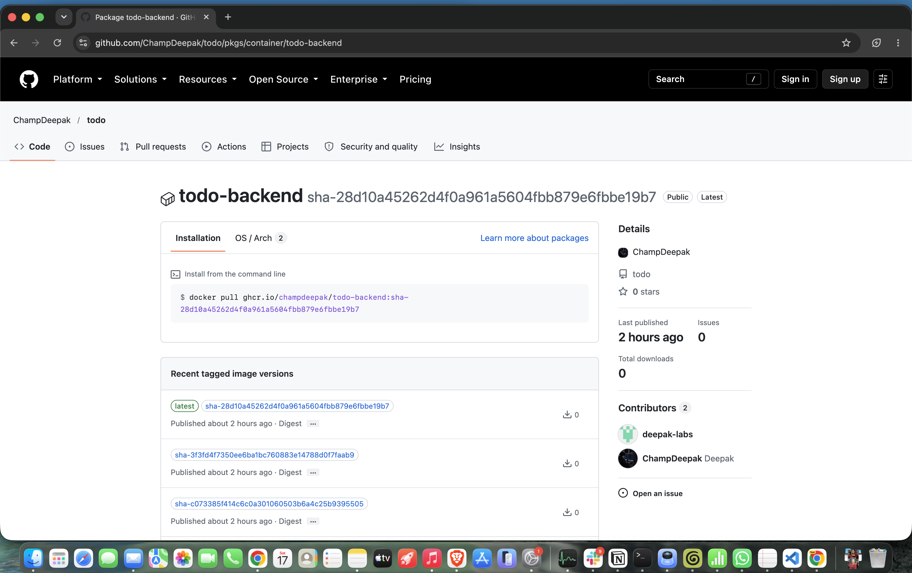
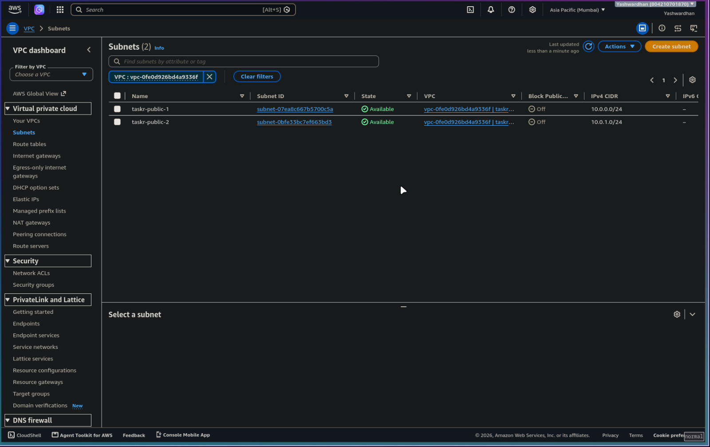
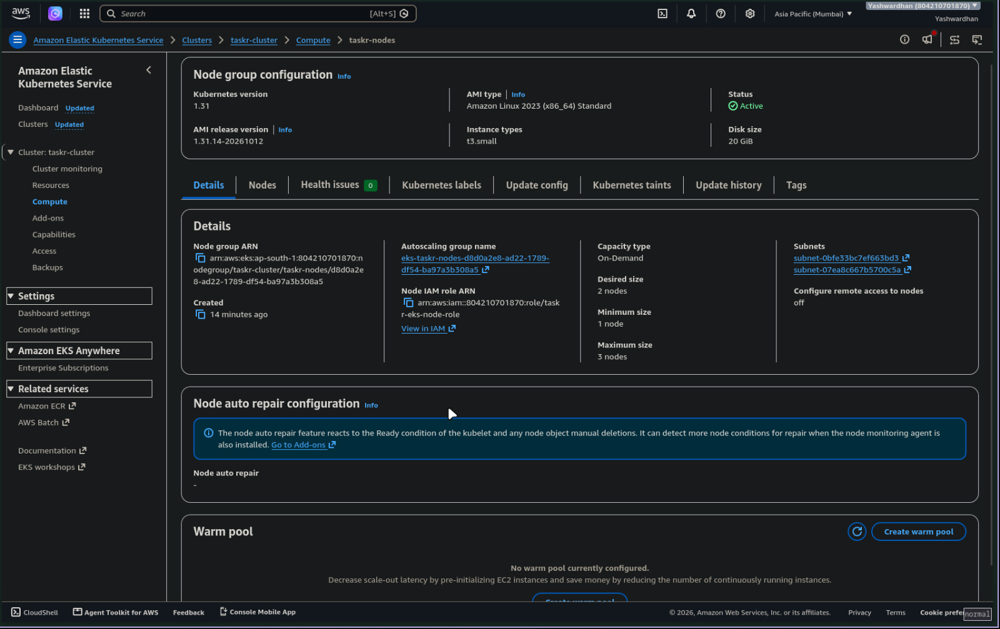

# Submission Evidence — Screenshot Tracker

## M1 — Application (10 pts)

### 1.1 Application running in the browser

- [x] **Save as:** `m1-app-browser.png`  ✅ captured
- **Capture:** open <http://localhost:3000>, show the task list with several tasks, the stats bar, and the create form.
- **Must be visible:** the URL bar showing `localhost:3000`, and a UI that is clearly not blank — the rubric gives 1 point for "responsive and usable UI (not a blank page)".


---

## M2 — Testing (10 pts)

### 2.1 Pytest passing

- [x] **Save as:** `m2-pytest-passing.png`  ✅ captured
- **Capture:** the terminal after `cd /Users/deepak/sst/todo/backend && .venv/bin/pytest -v`. Needs the compose Postgres running on port 5433, which it is.
- **Must be visible:** the full command, every test name with `PASSED`, and the green summary line (`N passed in Xs`). Scroll so the summary and at least 5 test names are in one frame.


---

## M3 — Git and GitHub (5 pts)

### 3.1 Commit history

- [x] **Save as:** `m3-commit-history.png`  ✅ captured
- **Capture:** <https://github.com/ChampDeepak/todo/commits/main>
- **Must be visible:** **at least 10 commits** with meaningful messages. The rubric explicitly rejects "update", "fix", "test" as messages.


---

## M4 — Docker (10 pts)

### 4.1 `docker compose up --build` succeeding

- [x] **Save as:** `m4-compose-up.png`  ✅ captured
- **Capture:** `cd /Users/deepak/sst/todo && docker compose ps` (the stack is already built and healthy), or re-run `docker compose up --build` for the full build log
- **Must be visible:** all three services (`db`, `backend`, `frontend`) reaching a started/healthy state in the same frame.


### 4.2 Application served from the container stack

- [x] **Save as:** `m4-app-browser.png`  ✅ captured
- **Capture:** <http://localhost:3000> while the compose stack is serving it (not the Vite dev server).
- **Must be visible:** the URL bar and a working app. This is a *different* screenshot from M1 — here the page is served by Nginx out of a container.


---

## M5 — CI/CD (15 pts)

### 5.1 Green GitHub Actions run

- [x] **Save as:** `m5-actions-green.png`  ✅ captured
- [ ] **Also record the run URL** in `README.md`
- **Capture:** <https://github.com/ChampDeepak/todo/actions> → the most recent green run on `main`
- **Must be visible:** every job green, including the test job, the frontend build, and both image builds.


### 5.2 GHCR packages with SHA tags

- [x] **Save as:** `m5-ghcr-packages.png`  ✅ captured
- **Capture:** <https://github.com/ChampDeepak?tab=packages> → `todo-backend` and `todo-frontend`
- **Must be visible:** both images published, tagged with the **Git commit SHA**. A screenshot showing only `latest` loses the 2 points for SHA-based tags.


### 5.2b GHCR package pages showing the SHA tags

- [x] **Save as:** `m5-ghcr-frontend-tags.png`  ✅ captured
- [x] **Save as:** `m5-ghcr-backend-tags.png`  ✅ captured
- **Capture:** <https://github.com/ChampDeepak/todo/pkgs/container/todo-frontend>
  and <https://github.com/ChampDeepak/todo/pkgs/container/todo-backend>
- **Why these exist:** the `?tab=packages` list in 5.2 proves both images were
  published but shows **no tags at all**. The rubric awards 2 points for tags
  that use the Git commit SHA rather than `latest`, so the tags have to be
  visible somewhere. These package pages show them, e.g.
  `sha-28d10a45262d4f0a961a5604fbb879e6fbbe19b7`, which is commit `28d10a4`.




---

## M6 — DevSecOps (5 pts)

### 6.1 Trivy scan output

- [x] **Save as:** `m6-trivy-output.png`  ✅ captured
- **Capture:** the Trivy step's log inside a GitHub Actions run —
  <https://github.com/ChampDeepak/todo/actions/runs/38936686470/job/117094046405#step:8:1>
- **You must be signed in to GitHub for this one.** Actions logs are not visible
  to logged-out visitors even on a public repo, so this is the one screenshot
  that could not be automated.
- **What the log says** (already verified against the run, so you can describe it
  before you even open it) — the scan is **clean**:

  ```text
  INFO  Detected OS  family="alpine" version="3.23.4"
  INFO  [alpine] Detecting vulnerabilities...  os_version="3.23" pkg_num=71

  Report Summary
  ┌──────────────────────────────────────────────────────┬────────┬─────────────────┬─────────┐
  │                        Target                        │  Type  │ Vulnerabilities │ Secrets │
  ├──────────────────────────────────────────────────────┼────────┼─────────────────┼─────────┤
  │ ghcr.io/champdeepak/todo-frontend:ci (alpine 3.23.4) │ alpine │        0        │    -    │
  └──────────────────────────────────────────────────────┴────────┴─────────────────┴─────────┘
  Legend:
  - '0': Clean (no security findings detected)
  ```

  Severity gate was `HIGH,CRITICAL`, and secret scanning ran alongside the
  vulnerability scan. Zero findings here is the *result of* the earlier fix —
  commit `d1fb04c` moved the base image to `nginx:1.29-alpine`. That is the story
  to tell: the gate caught a real problem, you fixed it, and the gate now passes.
- **Must be visible:** which image was scanned and the findings table (a clean result is acceptable and scores full marks).
- **Also needed:** a 2–3 sentence written explanation — this lives in `README.md`, not in the image.


---

## M7 — Terraform (15 pts)

> **Capture these in the order 7.2 → 7.3 → 7.4 → 7.1, not top to bottom.**
> The console shots must happen while the infrastructure is alive, and the plan
> shot is *easier* once it is gone. `terraform plan` only prints
> `Plan: N to add` when the thing is not built yet — against fully-applied
> infrastructure it prints `No changes`, which does not satisfy the "non-empty
> plan" criterion. So: screenshot the console (7.2, 7.3), destroy (7.4), then
> run `plan` against the now-empty state (7.1) and it shows the entire stack as
> `to add`. That also means the EKS cluster stops billing as early as possible.

### 7.1 `terraform plan` output

- [x] **Save as:** `m7-terraform-plan.png`  ✅ captured
- **Capture (do this LAST, after the destroy in 7.4):**
  `cd /Users/deepak/sst/todo/terraform && AWS_PROFILE=project terraform plan`
- **Must be visible:** the final summary line — `Plan: N to add, 0 to change, 0 to destroy` — with no errors above it.
- **Why after the destroy:** against live infrastructure this command prints
  `No changes`, which is not a non-empty plan. Against the empty post-destroy
  state it plans the whole stack, which is exactly the line the rubric wants.
  A plan makes no AWS resources and costs nothing, so this is safe to run.


### 7.2 AWS Console — VPC

- [x] **Save as:** `m7-aws-vpc.png`  ✅ captured
- **Capture:** <https://ap-south-1.console.aws.amazon.com/vpcconsole/home?region=ap-south-1#vpcs:> then the *Subnets* page
- **Look for:** VPC named **`taskr-vpc`**, and subnets **`taskr-public-1`** and **`taskr-public-2`** (one per availability zone)
- **Must be visible:** the region selector showing **Mumbai / ap-south-1**, and at least two public subnets. Account is `804210701870`, profile `project`.


### 7.2b AWS Console — Subnets

- [x] **Save as:** `m7-aws-subnets.png`  ✅ captured
- **Capture:** in the VPC console, left nav → **Subnets**, filter by VPC `taskr-vpc`
- **Look for:** `taskr-public-1` (`10.0.0.0/24`, `ap-south-1a`) and `taskr-public-2`
  (`10.0.1.0/24`, `ap-south-1b`), both **Available**
- **Why this is separate from 7.2:** the *Your VPCs* page proves the VPC exists but
  shows no subnets. The rubric gives 3 points for "VPC with **at least two public
  subnets**", so the subnet rows have to be visible somewhere. This is that shot.



### 7.3 AWS Console — EKS cluster

- [x] **Save as:** `m7-aws-eks.png`  ✅ captured
- **Capture:** <https://ap-south-1.console.aws.amazon.com/eks/home?region=ap-south-1#/clusters/taskr-cluster>
- **Look for:** cluster **`taskr-cluster`**, Kubernetes 1.31, node group **`taskr-nodes`**
- **Must be visible:** cluster status **`Active`** and the node group showing 2 nodes. Grab the *Compute* tab too if it fits.
- **Node size is `t3.small`, not `t3.medium`:** this AWS account is Free Tier-restricted
  and refuses to launch any instance type that is not free-tier eligible, so the
  original `t3.medium` node group failed with
  `InvalidParameterCombination - The specified instance type is not eligible for Free Tier`.
  If a grader asks why the nodes are small, that is the answer — and it is a real
  DevOps lesson: the cloud account's own policy is part of your infrastructure constraints.


### 7.3b AWS Console — EKS Compute tab (node group)

- [x] **Save as:** `m7-aws-eks-compute.png`  ✅ captured
- **Capture:** the cluster page → **Compute** tab
- **Look for:** node group `taskr-nodes`, status **Active**, desired size **2**,
  instance type **t3.small**, AMI `AL2023_x86_64_STANDARD`
- **Why this shot too:** the cluster overview's *Nodes* and *Pods* tiles read the
  **Kubernetes API** and can show `Data unavailable` for a few minutes after the
  nodes join, even with full cluster-admin access. The Compute tab reads the
  **AWS API** instead, so the node group and its size always render. That is the
  more reliable proof of "at least one worker node group".



### 7.4 `terraform destroy` completed

- [x] **Save as:** `m7-terraform-destroy.png`  ✅ captured
- **Capture:** `cd /Users/deepak/sst/todo/terraform && AWS_PROFILE=project terraform destroy` — I will run this for you; capture the final frame
- **Must be visible:** `Destroy complete! N resources destroyed.` This protects you from a runaway AWS bill *and* is worth 2 points.


---

## M8 — Kubernetes + Helm (15 pts)

### 8.1 Pods running

- [x] **Save as:** `m8-kubectl-pods.png`  ✅ captured
- **Capture:** `kubectl get pods -n <namespace>`
- **Must be visible:** every pod `Running` with `READY 1/1`, and **at least 2 replicas each** for backend and frontend.


### 8.2 Services

- [x] **Save as:** `m8-kubectl-svc.png`  ✅ captured
- **Capture:** `kubectl get svc -n <namespace>`
- **Must be visible:** ClusterIP services for both backend and frontend.


### 8.3 Helm release

- [x] **Save as:** `m8-helm-list.png`  ✅ captured
- **Capture:** `helm list -n <namespace>`
- **Must be visible:** the release with status `deployed`.


### 8.4 Application through the Ingress

- [x] **Save as:** `m8-app-ingress.png`  ✅ captured
- **Capture:** <http://localhost:8080> — the kind cluster maps your Mac's port 8080 to the Ingress controller inside the cluster.
- **Must be visible:** the URL bar showing **`localhost:8080`, not `localhost:3000`**. Port 3000 is the docker-compose stack from M4; 8080 is Kubernetes. Showing the wrong one loses the point.
- **First run this in your own terminal:** `kind export kubeconfig --name taskr`


---

## M9 — Observability (10 pts)

### 9.1 `/metrics` endpoint

- [x] **Save as:** `m9-metrics-curl.png`  ✅ captured
- **Capture:** the raw endpoint dumps Python GC metrics first, which proves little.
  This filters to the *application's* HTTP metrics instead — far better evidence:

  ```bash
  kubectl exec -n taskr deploy/backend -- python -c "
  import urllib.request
  m=urllib.request.urlopen('http://127.0.0.1:8000/metrics').read().decode()
  keep=[l for l in m.splitlines() if l.startswith(('# HELP http','# TYPE http')) or l.startswith('http_requests_total')]
  print('\n'.join(keep[:22]))
  "
  ```

- **Must be visible:** Prometheus text format — `# HELP` / `# TYPE` lines plus
  `http_requests_total` rows with real per-endpoint counts, e.g.
  `http_requests_total{handler="/api/tasks",method="GET",status="2xx"} 139.0`.
- **If a grader asks about the `4xx` counts:** they are real, and you should own
  them — traffic was generated against `/api/tasks?status=pending`, and `pending`
  is not a valid status (the enum is `todo`, `in_progress`, `done`), so FastAPI
  correctly returned 422. That is *why* the "Responses by status code" panel in
  Grafana has two series instead of one.


### 9.2 Prometheus targets

- [x] **Save as:** `m9-prometheus-targets.png`  ✅ captured
- **Capture:** <http://prometheus.localtest.me:8080> → *Status* → *Target health*. `localtest.me` resolves to 127.0.0.1, so no `/etc/hosts` edit is needed.
- **Must be visible:** the application target with state **`UP`** and a recent scrape time.


### 9.3 Grafana dashboard

- [x] **Save as:** `m9-grafana-dashboard.png`  ✅ captured
- **Capture:** <http://grafana.localtest.me:8080>, login `admin` / `admin`
- **Must be visible:** at least one panel with **actual plotted data** — request rate, latency, or error rate. An empty panel scores zero for this criterion, so generate traffic against the app first.


---

## M10 — Presentation + Documentation (5 pts)


### 10.1 Live demo recording

- [x] **Save as:** `m10-demo.mov`  ✅ captured — 7:45, narrated, committed
- **What it covers:** the deploy loop (code change → push → CI → Helm rollout →
  rollback), the observability stack, and the cloud teardown ending on
  `Destroy complete! 15 resources destroyed` and `Plan: 15 to add`.
- **Capture:** commit a change → the pipeline runs → the deployment updates with the new image.
- **Must be visible:** all three stages, as one continuous story.

`README.md` itself is the other deliverable here — no screenshot needed.

---

## Final submission check

Before you submit, confirm every box above is ticked and every image renders
when this file is viewed on GitHub. A broken image link means the grader sees
nothing and awards nothing.
