# Submission Evidence — Screenshot Tracker

Every screenshot the rubric asks for, in one place. Save each file into
`docs/screenshots/` using **exactly** the filename in the `Save as` column — the
image links below are already written against those names, so a correctly named
file makes the entry render automatically.

**How to capture on macOS**

| Need | How |
|---|---|
| A region | `Cmd+Shift+4`, then drag |
| A single window, with shadow | `Cmd+Shift+4`, then `Space`, then click the window |
| A screen recording | `Cmd+Shift+5` → *Record Selected Portion* |
| From the terminal, no mouse | `screencapture -w docs/screenshots/NAME.png` (click target window) |

Screenshots land on the Desktop by default. Move them in with:
`mv ~/Desktop/"Screenshot "*.png docs/screenshots/NAME.png`

---

## Progress

| Module | Evidence needed | Captured |
|---|---|---|
| M1 — Application | 1 | ☐ 0 / 1 |
| M2 — Testing | 1 | ☐ 0 / 1 |
| M3 — Git & GitHub | 1 | ☐ 0 / 1 |
| M4 — Docker | 2 | ☐ 0 / 2 |
| M5 — CI/CD | 2 | ☐ 0 / 2 |
| M6 — DevSecOps | 1 | ☐ 0 / 1 |
| M7 — Terraform | 4 | ☐ 0 / 4 |
| M8 — Kubernetes + Helm | 4 | ☐ 0 / 4 |
| M9 — Observability | 3 | ☐ 0 / 3 |
| M10 — Presentation | 1 recording | ☐ 0 / 1 |
| **Total** | **19 + 1 recording** | |

---

## M1 — Application (10 pts)

### 1.1 Application running in the browser

- [ ] **Save as:** `m1-app-browser.png`
- **Capture:** open <http://localhost:3000>, show the task list with several tasks, the stats bar, and the create form.
- **Must be visible:** the URL bar showing `localhost:3000`, and a UI that is clearly not blank — the rubric gives 1 point for "responsive and usable UI (not a blank page)".

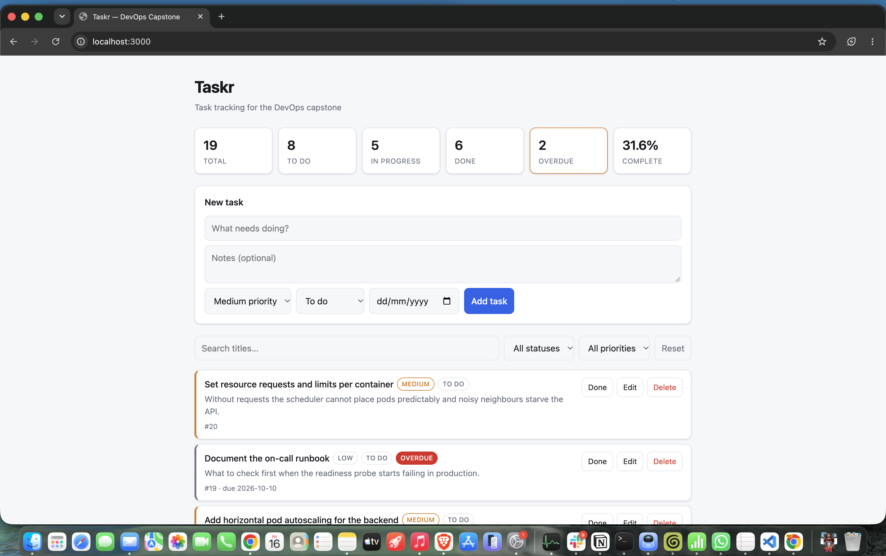

---

## M2 — Testing (10 pts)

### 2.1 Pytest passing

- [ ] **Save as:** `m2-pytest-passing.png`
- **Capture:** the terminal after `cd /Users/deepak/sst/todo/backend && .venv/bin/pytest -v`. Needs the compose Postgres running on port 5433, which it is.
- **Must be visible:** the full command, every test name with `PASSED`, and the green summary line (`N passed in Xs`). Scroll so the summary and at least 5 test names are in one frame.

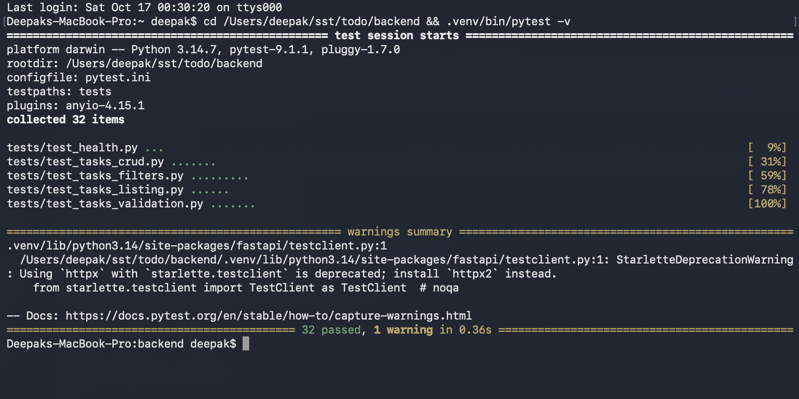

---

## M3 — Git and GitHub (5 pts)

### 3.1 Commit history

- [ ] **Save as:** `m3-commit-history.png`
- **Capture:** <https://github.com/ChampDeepak/todo/commits/main>
- **Must be visible:** **at least 10 commits** with meaningful messages. The rubric explicitly rejects "update", "fix", "test" as messages.

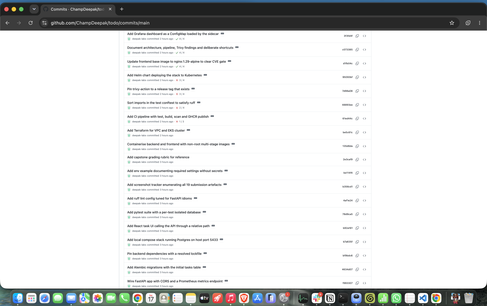

---

## M4 — Docker (10 pts)

### 4.1 `docker compose up --build` succeeding

- [ ] **Save as:** `m4-compose-up.png`
- **Capture:** `cd /Users/deepak/sst/todo && docker compose ps` (the stack is already built and healthy), or re-run `docker compose up --build` for the full build log
- **Must be visible:** all three services (`db`, `backend`, `frontend`) reaching a started/healthy state in the same frame.

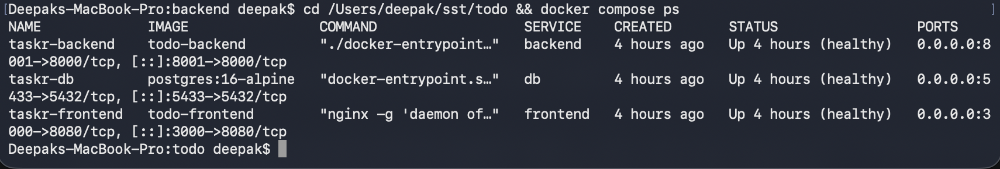

### 4.2 Application served from the container stack

- [ ] **Save as:** `m4-app-browser.png`
- **Capture:** <http://localhost:3000> while the compose stack is serving it (not the Vite dev server).
- **Must be visible:** the URL bar and a working app. This is a *different* screenshot from M1 — here the page is served by Nginx out of a container.

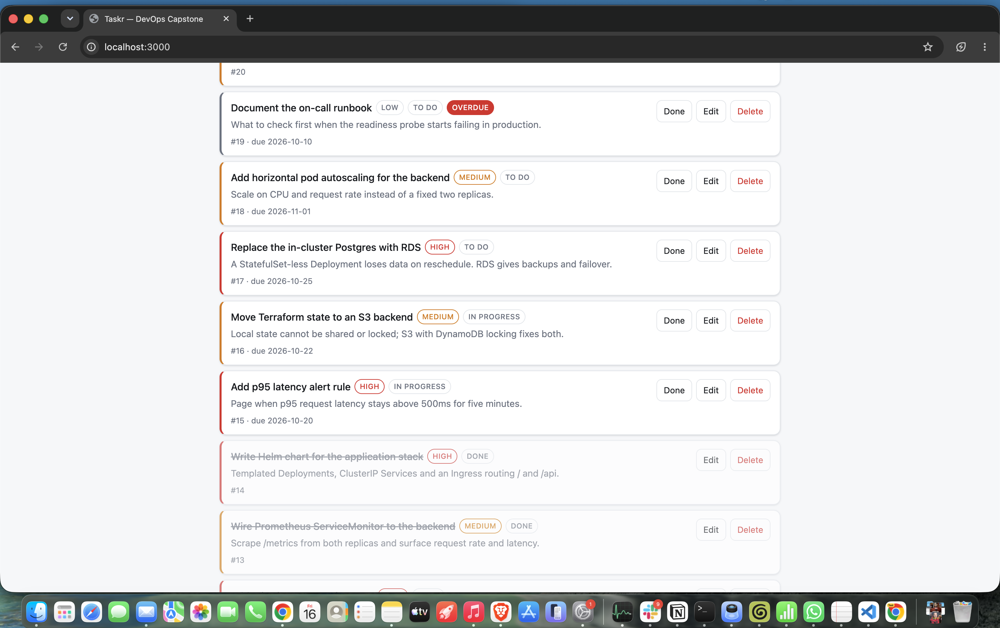

---

## M5 — CI/CD (15 pts)

### 5.1 Green GitHub Actions run

- [ ] **Save as:** `m5-actions-green.png`
- [ ] **Also record the run URL** in `README.md`
- **Capture:** <https://github.com/ChampDeepak/todo/actions> → the most recent green run on `main`
- **Must be visible:** every job green, including the test job, the frontend build, and both image builds.

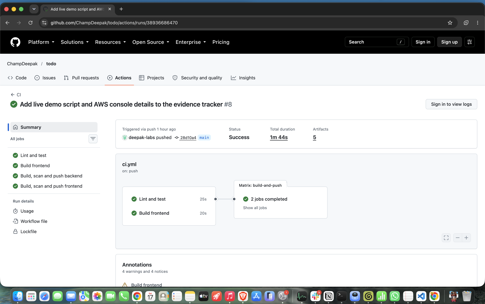

### 5.2 GHCR packages with SHA tags

- [ ] **Save as:** `m5-ghcr-packages.png`
- **Capture:** <https://github.com/ChampDeepak?tab=packages> → `todo-backend` and `todo-frontend`
- **Must be visible:** both images published, tagged with the **Git commit SHA**. A screenshot showing only `latest` loses the 2 points for SHA-based tags.

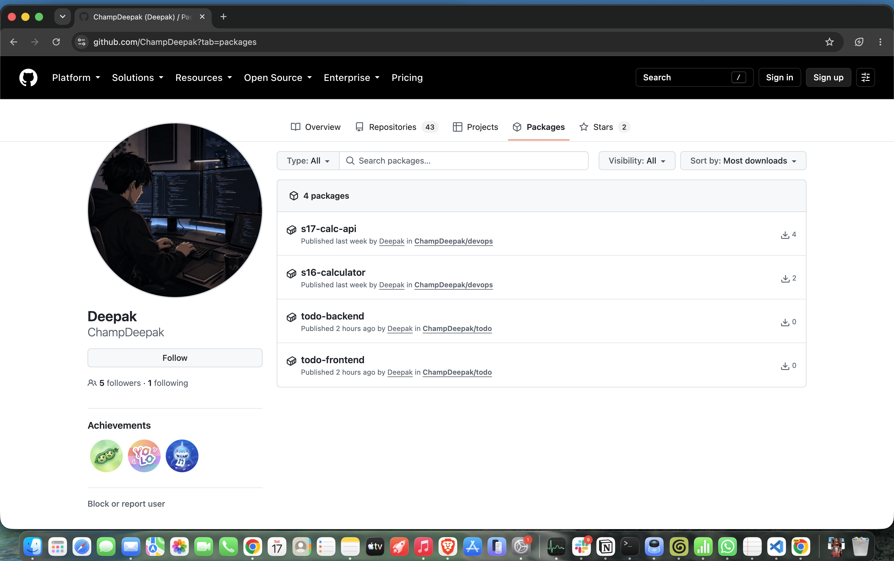

---

## M6 — DevSecOps (5 pts)

### 6.1 Trivy scan output

- [ ] **Save as:** `m6-trivy-output.png`
- **Capture:** the Trivy step's log inside a GitHub Actions run
- **Must be visible:** which image was scanned and the findings table (a clean result is acceptable and scores full marks).
- **Also needed:** a 2–3 sentence written explanation — this lives in `README.md`, not in the image.

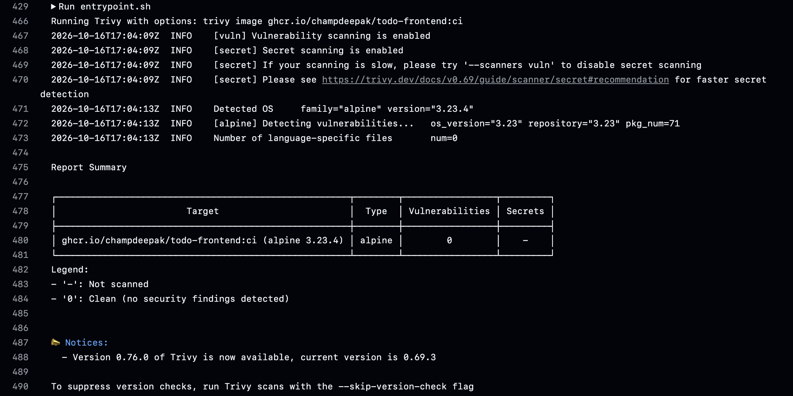

---

## M7 — Terraform (15 pts)

### 7.1 `terraform plan` output

- [ ] **Save as:** `m7-terraform-plan.png`
- **Capture:** terminal running `terraform plan`
- **Must be visible:** the final summary line — `Plan: N to add, 0 to change, 0 to destroy` — with no errors above it.

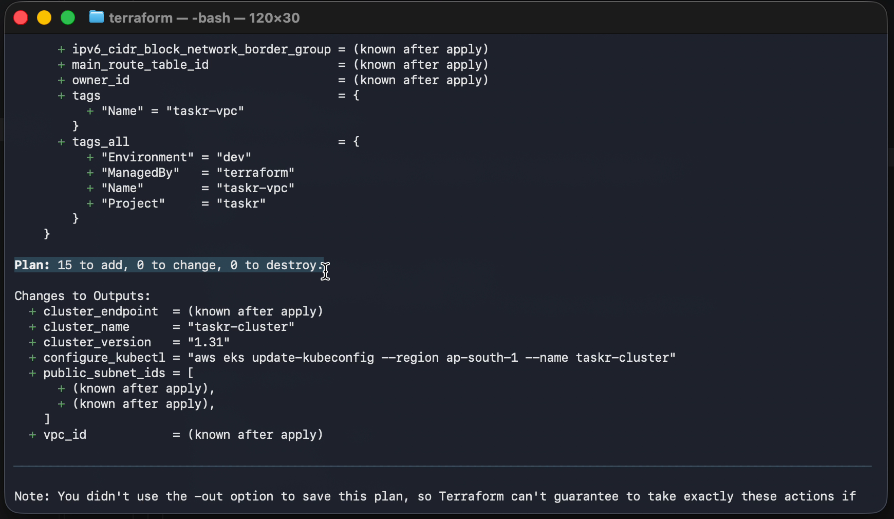

### 7.2 AWS Console — VPC

- [ ] **Save as:** `m7-aws-vpc.png`
- **Capture:** AWS Console → VPC → *Your VPCs*, and the *Subnets* list
- **Must be visible:** the VPC and **at least two public subnets**, with the region selector showing the expected region.

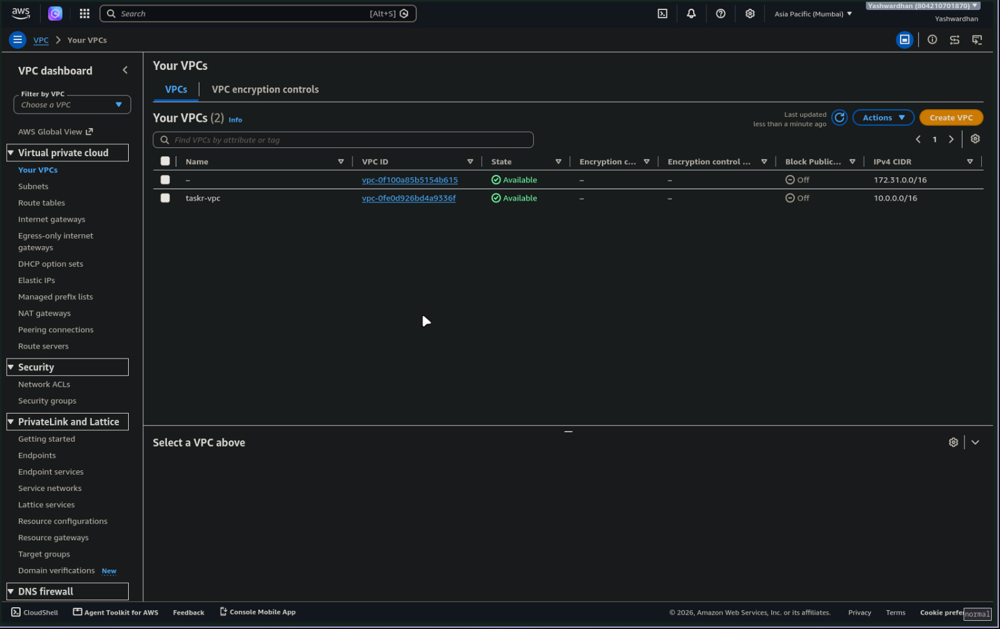

### 7.3 AWS Console — EKS cluster

- [ ] **Save as:** `m7-aws-eks.png`
- **Capture:** AWS Console → EKS → the cluster's overview page
- **Must be visible:** cluster status `Active`, and the node group with at least one worker node.

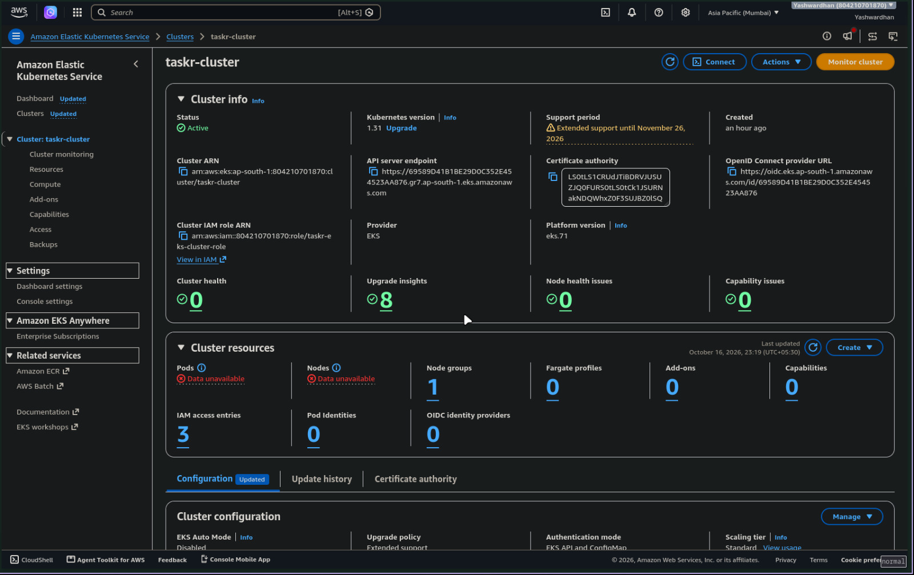

### 7.4 `terraform destroy` completed

- [ ] **Save as:** `m7-terraform-destroy.png`
- **Capture:** terminal after `terraform destroy`
- **Must be visible:** `Destroy complete! N resources destroyed.` This protects you from a runaway AWS bill *and* is worth 2 points.

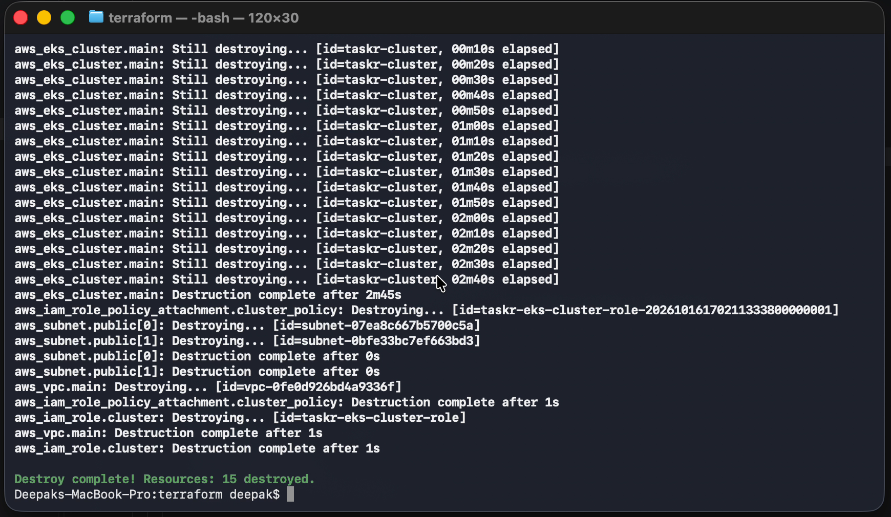

---

## M8 — Kubernetes + Helm (15 pts)

### 8.1 Pods running

- [ ] **Save as:** `m8-kubectl-pods.png`
- **Capture:** `kubectl get pods -n <namespace>`
- **Must be visible:** every pod `Running` with `READY 1/1`, and **at least 2 replicas each** for backend and frontend.

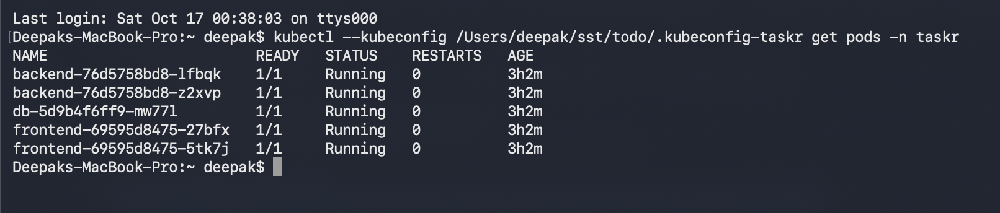

### 8.2 Services

- [ ] **Save as:** `m8-kubectl-svc.png`
- **Capture:** `kubectl get svc -n <namespace>`
- **Must be visible:** ClusterIP services for both backend and frontend.

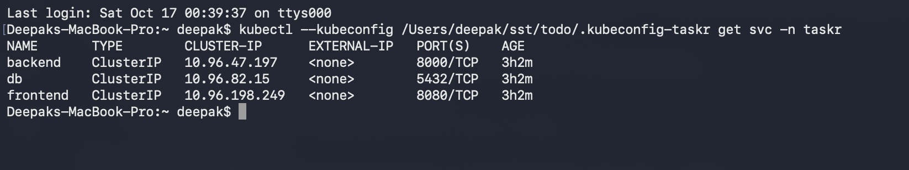

### 8.3 Helm release

- [ ] **Save as:** `m8-helm-list.png`
- **Capture:** `helm list -n <namespace>`
- **Must be visible:** the release with status `deployed`.

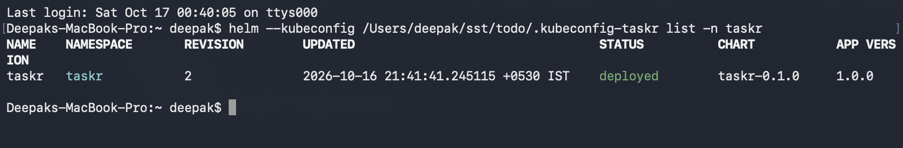

### 8.4 Application through the Ingress

- [ ] **Save as:** `m8-app-ingress.png`
- **Capture:** <http://localhost:8080> — the kind cluster maps your Mac's port 8080 to the Ingress controller inside the cluster.
- **Must be visible:** the URL bar showing **`localhost:8080`, not `localhost:3000`**. Port 3000 is the docker-compose stack from M4; 8080 is Kubernetes. Showing the wrong one loses the point.
- **First run this in your own terminal:** `kind export kubeconfig --name taskr`

---

## M9 — Observability (10 pts)

### 9.1 `/metrics` endpoint

- [ ] **Save as:** `m9-metrics-curl.png`
- **Capture:** `kubectl exec -n taskr deploy/backend -- python -c "import urllib.request;print(urllib.request.urlopen('http://127.0.0.1:8000/metrics').read().decode()[:1500])"`
- **Must be visible:** Prometheus text format — `# HELP` / `# TYPE` lines and real counter values.

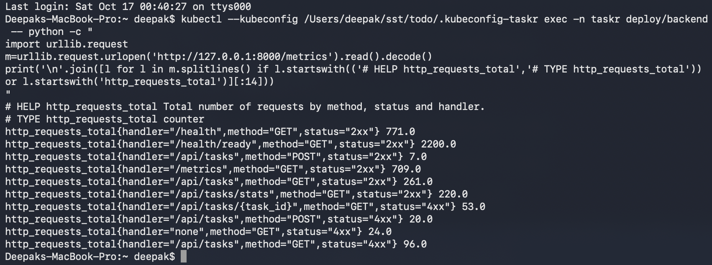

### 9.2 Prometheus targets

- [ ] **Save as:** `m9-prometheus-targets.png`
- **Capture:** <http://prometheus.localtest.me:8080> → *Status* → *Target health*. `localtest.me` resolves to 127.0.0.1, so no `/etc/hosts` edit is needed.
- **Must be visible:** the application target with state **`UP`** and a recent scrape time.

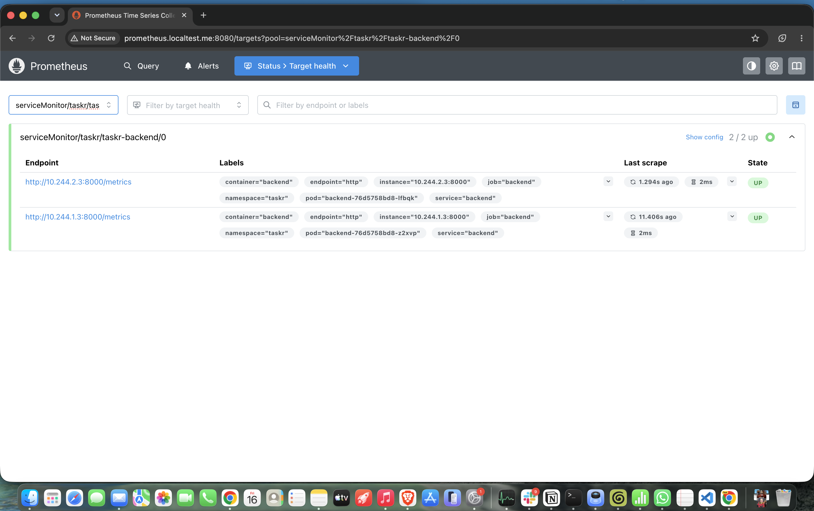

### 9.3 Grafana dashboard

- [ ] **Save as:** `m9-grafana-dashboard.png`
- **Capture:** <http://grafana.localtest.me:8080>, login `admin` / `admin`
- **Must be visible:** at least one panel with **actual plotted data** — request rate, latency, or error rate. An empty panel scores zero for this criterion, so generate traffic against the app first.

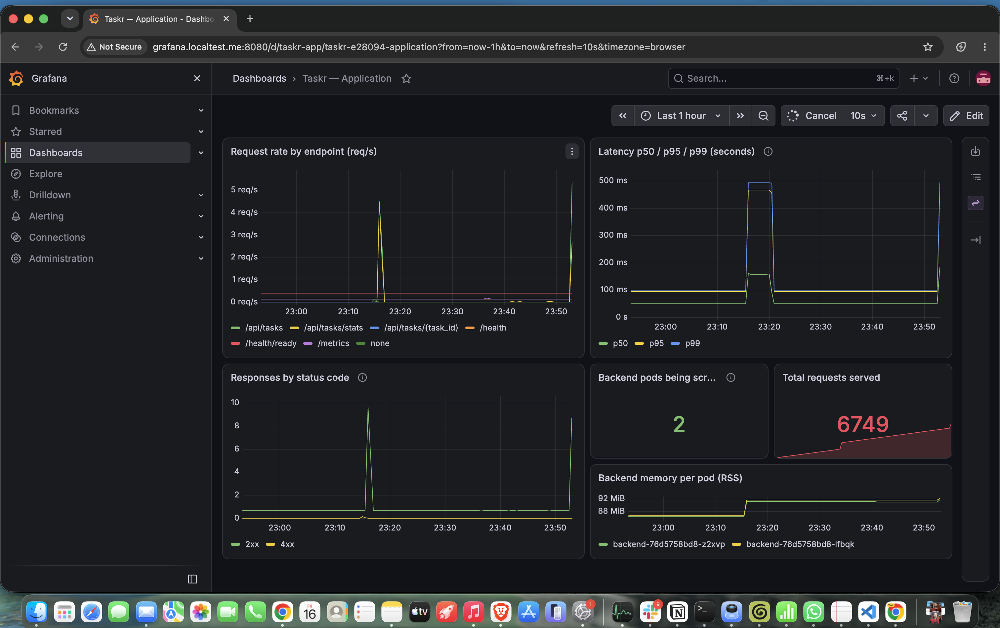

---

## M10 — Presentation + Documentation (5 pts)

### 10.1 Live demo recording

- [ ] **Save as:** `m10-demo.mov` (only if presenting remotely)
- **Capture:** commit a change → the pipeline runs → the deployment updates with the new image.
- **Must be visible:** all three stages, as one continuous story.

`README.md` itself is the other deliverable here — no screenshot needed.

---

## Final submission check

Before you submit, confirm every box above is ticked and every image renders
when this file is viewed on GitHub. A broken image link means the grader sees
nothing and awards nothing.
